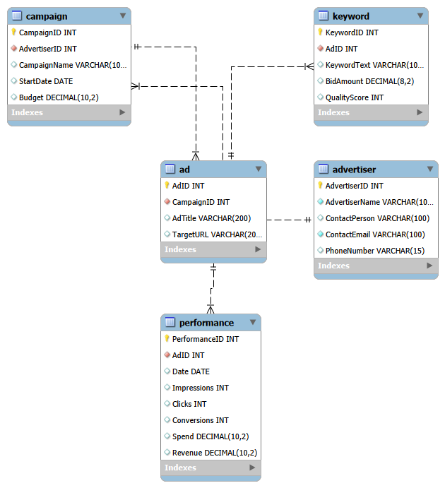
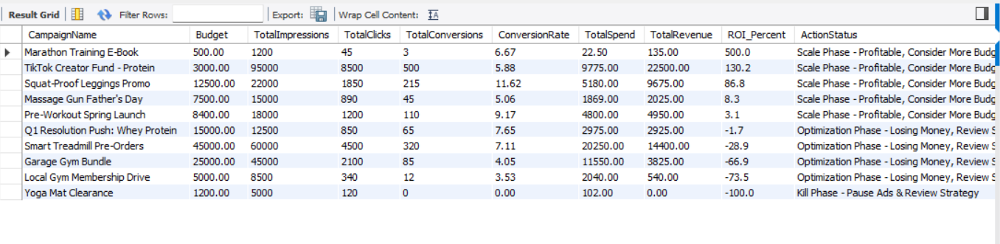

# ApexFit: Marketing Analytics SQL Database

## Overview
A MySQL database that tracks ad performance for a fitness brand and shows which campaigns make money and which waste budget. It uses **sample data** created for this project, not real company data.

## Business question
Which campaigns are profitable, which are losing money, and which should be paused?

## Database design
Five tables linked by IDs, so each piece of information is stored once:

- **Advertiser**: who runs the campaigns
- **Campaign**: marketing objective and budget
- **Ad**: the individual ads in each campaign
- **Keyword**: search terms and bid amounts for each ad
- **Performance**: daily impressions, clicks, conversions, spend and revenue

## Assumptions
- **Spend** = clicks × the ad's average keyword bid
- **Revenue** = conversions × an assumed order value of £45
- Because both are estimates, the ROI figures are illustrative only.

## Analysis queries
1. **Campaign ROI and action status** joins four tables and calculates conversion rate, spend, revenue and ROI. A CASE statement labels each campaign:
   - **Kill Phase**: spend of £50 or more and zero conversions
   - **Optimization Phase**: losing money (revenue below spend)
   - **Scale Phase**: profitable
2. **Keyword bid efficiency** compares quality score, bids and conversions.
3. **vw_WinningCreatives** is a view of ads with a click-through rate above 4%, ready to feed a dashboard.

## Sample result

Yoga Mat Clearance is flagged for pausing: £102 spent and no conversions. Four campaigns, including Smart Treadmill Pre-Orders, are losing money and need review.

## How to run
Run the files in order in MySQL:
1. `01_schema_creation.sql`: creates the tables
2. `02_mock_data.sql`: inserts sample data and calculates spend and revenue
3. `03_analysis_queries.sql`: runs the analysis

## Possible next steps
- Build a Power BI dashboard from the ROI query and the view
- Replace the sample data with real campaign data
